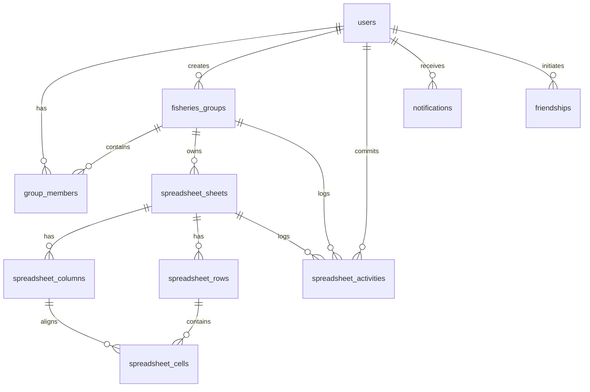

# Project Context: Dadhen Mandiri

## 1. Executive Summary

**Dadhen Mandiri** is a Laravel-based web platform designed for operational management, financial calculation, and high-fidelity spreadsheet bookkeeping for aquaculture businesses (fisheries, shrimp/fish pond cultivation, and processing).

The application is currently transitioning from a multi-tenant/collaborative team workspace model into a **centralized single-company management and financial spreadsheet platform** structured around financial years, monthly accounting cycles, and five core operational spreadsheets.

---

## 2. Technology Stack & Environment

| Component | Specification / Version | Source / Notes |
|---|---|---|
| **PHP** | `8.2.12` (CLI, ZTS Visual C++ 2019 x64) | Minimum requirement `^8.2` in `composer.json` |
| **Framework** | **Laravel Framework `12.70.0`** | `laravel/framework: ^12.0` |
| **Component Engine** | **Livewire `v3.5.x`** | `livewire/livewire: ^3.5` |
| **Spreadsheet Engine** | **PhpSpreadsheet `5.10`** | `phpoffice/phpspreadsheet: ^5.10` |
| **Frontend Styling** | **Tailwind CSS (CDN)** | `https://cdn.tailwindcss.com` (Dark Navy `#0A192F` theme) |
| **Client-Side Reactivity** | **Alpine.js (Bundled with Livewire 3)** | Native Livewire 3 runtime (no duplicate CDN Alpine script) |
| **Typography** | Google Fonts: Inter & JetBrains Mono | Monospace `tabular-nums` for spreadsheet financial figures |
| **Build System / Asset Pipeline** | **None (Zero Node/Vite Dependency)** | Assets served via CDN, Blade, and public assets |
| **Database (Production/Dev)** | **MySQL 8.x** | Configured in `.env` (`DB_CONNECTION=mysql`, database `dadhen_mandiri`) |
| **Database (Automated Testing)** | **SQLite In-Memory (`:memory:`)** | Configured in `phpunit.xml` |
| **Timezone** | `Asia/Jakarta` (WIB, UTC+7) | Enforced across application and audit timestamps |

---

## 3. Repository Architecture & Layout

```
JOB 1/
├── app/
│   ├── Http/
│   │   ├── Controllers/
│   │   │   ├── AuthController.php                       # Authentication, registration, login
│   │   │   ├── CompanyYearController.php                # Operational years CRUD, archiving, restore, analytics
│   │   │   ├── CompanyUserController.php                # User Management (Owner only)
│   │   │   ├── CompanyActivityLogController.php         # Activity Logs viewer (Owner only)
│   │   │   ├── Controller.php                           # Base controller
│   │   │   ├── DashboardController.php                  # Dashboard metrics, operational years overview, friends
│   │   │   ├── GroupController.php                      # Workspace management, member roles, security unlock
│   │   │   └── SpreadsheetController.php                # Cell mutation API, CSV import/export, col/row CRUD
│   │   └── Middleware/
│   │       └── EnsureWorkspaceAdminReauthentication.php # Guard preventing unauthorized workspace navigation
│   ├── Livewire/
│   │   ├── SpreadsheetWorksheet.php                     # Core 1600+ line spreadsheet engine component
│   │   └── WorkspaceActivityHistory.php                 # Real-time activity audit history drawer
│   ├── Models/
│   │   ├── User.php                                     # User accounts (Owner vs Admin role methods, is_active, last_active_at)
│   │   ├── CompanyActivityLog.php                       # Company audit log model
│   │   ├── OperationalYear.php                          # Operational fiscal years (active, archived)
│   │   ├── MonthlyWorkspace.php                         # Monthly workspace periods (Jan-Dec)
│   │   ├── FisheriesGroup.php                           # Workspaces (legacy groups & monthly cycles)
│   │   ├── GroupMember.php                              # Workspace memberships & roles
│   │   ├── SpreadsheetSheet.php                         # Worksheets (Analisa, Cost, Margin, etc.)
│   │   ├── SpreadsheetColumn.php                        # Grid columns (sort order, width, letter)
│   │   ├── SpreadsheetRow.php                           # Grid rows (sort order, height)
│   │   ├── SpreadsheetCell.php                          # Grid cells (value, formula, format, version)
│   │   ├── SpreadsheetActivity.php                      # Granular audit log for every cell/workspace event
│   │   ├── Friendship.php                               # Peer user connections
│   │   └── Notification.php                             # In-app notifications
│   ├── Policies/
│   │   ├── SpreadsheetPolicy.php                        # Sheet view/edit authorization
│   │   └── WorkspacePolicy.php                          # Workspace role & membership policy
│   ├── Providers/
│   │   └── AppServiceProvider.php                       # Service registration & observers
│   └── Services/
│       ├── CompanyAnalyticsService.php                  # Aggregated analytics (Overview, Financial, Ops, Comparison)
│       ├── CompanyWorkspaceInitializer.php              # Dynamic year & monthly workspace provisioning
│       ├── OktAnalisaTemplateImporter.php               # Imports "Okt Analisa .xlsx" into database grid
│       ├── SpreadsheetActivityRecorder.php              # Auditing service for cell & workspace actions
│       ├── SpreadsheetFormulaEngine.php                 # Fast client/server arithmetic & formula parser
│       ├── SpreadsheetFormulaReferenceRewriter.php      # Formula rewriter during sheet rename/import
│       ├── SpreadsheetWorkbookCalculator.php            # Multi-sheet calculation engine via PhpSpreadsheet
│       └── SpreadsheetXlsxExporter.php                  # High-fidelity OpenXML XML-level XLSX exporter
├── config/                                              # Laravel configuration files (app, database, spreadsheet, etc.)
├── database/
│   ├── migrations/                                      # 21 database migrations
│   └── seeders/                                         # Database seeders
├── DATA & TEMPLATE EXCELL/
│   └── Okt Analisa .xlsx                                # Canonical production spreadsheet template (5 sheets)
├── public/                                              # Web root (images, icons, uploads)
├── resources/
│   └── views/
│       ├── auth/                                        # login.blade.php, register.blade.php
│       ├── company/                                     # analytics.blade.php, comparison.blade.php
│       ├── components/                                  # card.blade.php, modal.blade.php
│       ├── groups/
│       │   └── workspace.blade.php                      # Workspace container & tabs
│       ├── layouts/                                     # app.blade.php, auth.blade.php
│       ├── livewire/
│       │   ├── spreadsheet-worksheet.blade.php          # 2000+ line reactive spreadsheet UI
│       │   └── workspace-activity-history.blade.php     # Audit drawer view
│       └── users/
│           └── profile.blade.php                        # User profile view
├── routes/
│   ├── console.php                                      # Console commands
│   └── web.php                                          # Application routes
├── storage/                                             # App logs, file uploads, backups
├── tests/
│   ├── TestCase.php                                     # Base test case
│   └── Feature/                                         # Feature test suite (6 feature test files)
├── composer.json                                        # PHP dependencies
└── phpunit.xml                                          # PHPUnit testing configuration
```

---

## 4. Database Schema & Entity Relationships



### Table Details:
1. **`users`**: User authentication records (`name`, `email`, `password`, `whatsapp`, `role_title`, `avatar`).
2. **`fisheries_groups`**: Currently represents a "workspace" (`name`, `description`, `category`, `invite_code`, `password`, `location`, `pond_count`, `avatar`, `created_by`).
3. **`group_members`**: Pivot table connecting users to workspaces (`group_id`, `user_id`, `role`, `status`, `joined_at`).
4. **`spreadsheet_sheets`**: Individual sheets within a workspace (`group_id`, `name`, `category`, `metadata`). The `metadata` JSON stores freeze panes, merged ranges, default column widths, default row heights, and identity color keys.
5. **`spreadsheet_columns`**: Column definitions per sheet (`sheet_id`, `letter`, `title`, `width`, `sort_order`).
6. **`spreadsheet_rows`**: Row definitions per sheet (`sheet_id`, `sort_order`, `height`).
7. **`spreadsheet_cells`**: Individual cell data (`row_id`, `column_id`, `value`, `formula`, `format`, `version`). The `format` JSON stores XLSX styles (borders, fills, fonts, alignments), formatting flags, and data types.
8. **`spreadsheet_activities`**: Granular immutable event logs (`event_uuid`, `group_id`, `sheet_id`, `user_id`, `action`, `cell_range`, `old_value`, `new_value`, `details`, `committed_at`).
9. **`friendships`**: Peer connections (`user_id`, `friend_id`, `status`).
10. **`notifications`**: User alert items (`user_id`, `type`, `title`, `description`, `is_read`, `data`).

---

## 5. Implementation Conventions & Rules

1. **Spreadsheet Engine Integrity**:
   - The cell grid is materialized on demand: empty virtual cells do not create unnecessary database rows until typed into.
   - Mathematical calculations use two tiers:
     - **Tier 1 (Fast Evaluation)**: Handled by `SpreadsheetFormulaEngine.php` for common formulas (`SUM`, `AVERAGE`, `MIN`, `MAX`, basic arithmetic, percentages, and dashes).
     - **Tier 2 (Full Cross-Sheet Calculation)**: Handled by `SpreadsheetWorkbookCalculator.php` using `PhpSpreadsheet` to resolve dependencies across worksheets (e.g., `Cost` referencing `Analisa`, `Margin` referencing `Cost`, `Rank` referencing `Margin`).
   - Formula text is always preserved in `formula`, while evaluated outputs are cached in `value`.
2. **Optimistic Locking & Concurrency**:
   - `SpreadsheetCell.version` increments on every save. Stale writes trigger a conflict alert and reload the latest data without silent data overwrites.
3. **High-Fidelity Excel Export**:
   - `SpreadsheetXlsxExporter.php` writes full workbook structures, styling, formulas, merged cells, and directly patches the OpenXML XML payload (`/xl/worksheets/sheet*.xml`) using `DOMDocument` to embed calculated values in `<v>` tags, preventing Excel repair warnings and `#VALUE!` errors on open.
4. **Security & Session Guard**:
   - `EnsureWorkspaceAdminReauthentication` middleware enforces that Admin users must re-authenticate with their account password when leaving protected workspace sheets.
   - Founder protection ensures the workspace creator (`created_by`) can never be demoted or removed.

