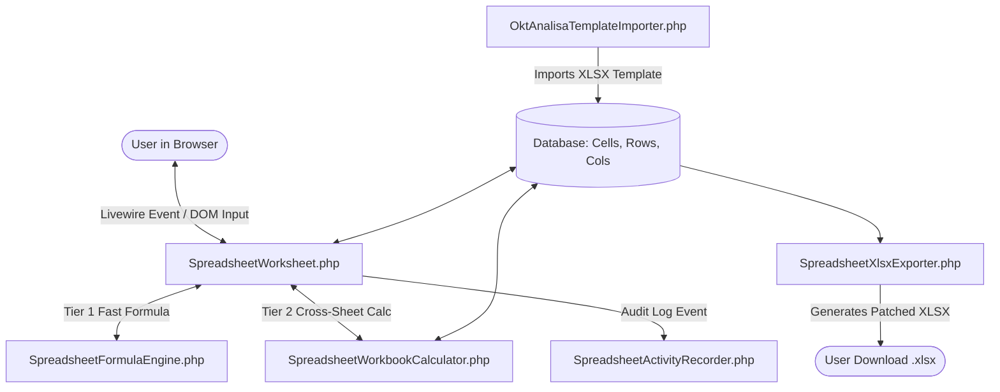
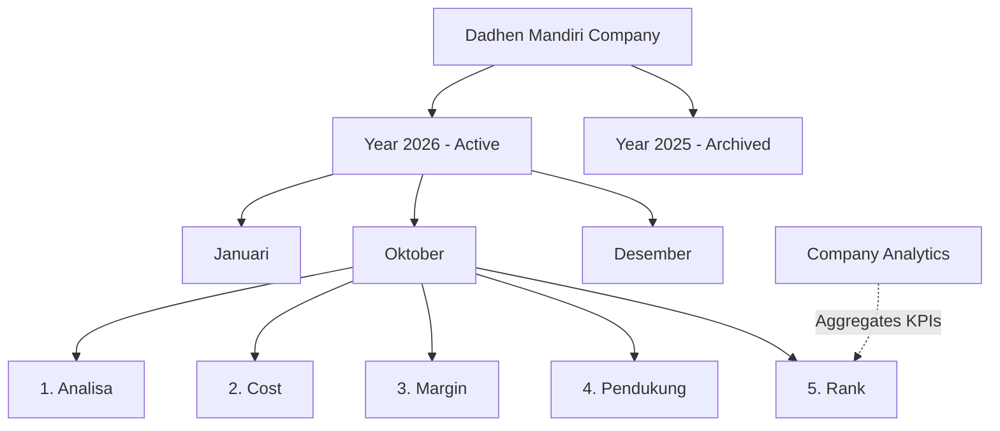

# Comprehensive System Audit Report: Dadhen Mandiri

**Date of Audit:** November 8, 2026  
**Auditor:** Antigravity AI Senior Systems Architect  
**Project Base Path:** `c:\Users\Crissencio Dheni S\Documents\JOB 1`  
**Application Title:** Dadhen Mandiri — Collaborative Fisheries & Aquaculture Spreadsheet Platform  

---

## 1. Executive Summary

This technical audit provides an exhaustive evaluation of the Dadhen Mandiri application codebase to prepare for its architectural evolution from a **multi-workspace/team-based model** into a **centralized company management and spreadsheet platform**.

The application currently has **5 workspace groups**, **25 spreadsheet sheets**, and **6,096 cell records** in production/dev storage. All core spreadsheet behaviors—including cell formula evaluation, cross-sheet references, cell styling, autosaving, history logging, and high-fidelity OpenXML Excel exports—are fully operational and must be strictly preserved during the transition.

---

## 2. Technical Stack & Environment Analysis

### 2.1 Framework & Core Dependencies

| Package / Tool | Version Detected | Evaluation & Compatibility |
|---|---|---|
| **PHP Runtime** | `8.2.12` | Meets composer requirement `^8.2`. Note: CLI runs ZTS on Windows; production deployments should run PHP 8.2+ with `pdo_mysql`, `zip`, `dom`, `libxml`, and `gd` enabled. |
| **Laravel Framework** | `12.70.0` | Latest Laravel 12 release. Uses `bootstrap/app.php` unified application configuration without `app/Http/Kernel.php`. |
| **Livewire** | `3.5.x` | Livewire 3 component architecture. Bundles Alpine.js internally; does not require external Alpine CDN. |
| **PhpSpreadsheet** | `5.10` | Primary engine for template loading, background cross-sheet formula calculation, and XLSX parsing. |
| **Frontend Styling** | Tailwind CSS CDN | Embedded via `<script src="https://cdn.tailwindcss.com"></script>` with customized navy palette (`#0A192F`, `#112240`, `#38BDF8`). |
| **Build Tools** | **None** | No `package.json`, Vite, or Webpack configuration. Application is 100% server-rendered and CDN-backed, which simplifies deployment and removes Node build pipeline failures. |
| **Databases** | MySQL (Default) / SQLite (Testing) | MySQL 8 for development/production (`dadhen_mandiri`), SQLite in-memory for PHPUnit feature tests. |

---

## 3. Existing Architecture & Directory Audit

### 3.1 Routing & Controllers
- **`routes/web.php`**: 81 lines defining authentication, dashboard, social/friend networking, workspace, and spreadsheet endpoints.
- **`AuthController.php`**: Standard session-based authentication (`login`, `register`, `logout`). Quick-fill demo credentials exist for testing.
- **`DashboardController.php`**: Computes aggregated KPI metrics from user memberships, handles workspace creation (`createGroup`), workspace joining (`joinGroup`), and peer networking.
- **`GroupController.php`**: Serves workspace view (`workspace()`), handles member role updates (`updateMemberRole()`), password unlocking (`unlock()`), XLSX backup download (`backupXlsx()`), and sheet management.
- **`SpreadsheetController.php`**: RESTful API endpoints for raw CSV import/export, direct cell persistence (`saveCell()`), and column/row additions/deletions.

### 3.2 Middleware
- **`EnsureWorkspaceAdminReauthentication.php`**: Intercepts requests for Admin users leaving a workspace. If an Admin has entered a protected workspace sheet, navigating away or logging out forces a password re-entry flow to prevent session hijacking on shared workstations.

### 3.3 Policies
- **`WorkspacePolicy.php`**: Enforces permissions for viewing, updating, deleting workspaces, adding members, and modifying roles. Specifically protects the founder (`isFounder`) from role demotion or removal.
- **`SpreadsheetPolicy.php`**: Controls sheet-level read/write permissions.

---

## 4. Existing Spreadsheet Engine Audit

The spreadsheet engine in Dadhen Mandiri is custom-engineered and comprised of five specialized components:



### 4.1 Component Breakdown
1. **`SpreadsheetWorksheet.php` (Livewire Component - 1,642 lines)**:
   - **Cell Virtualization & Canvas Projection**: Automatically renders a projected 26-column (A–Z) by 30-row canvas. Empty cells do not exist in the database until explicitly modified (`ensureGridCell`), keeping database storage lean.
   - **Optimistic Concurrency Control**: Tracks `version` on each `SpreadsheetCell`. If a user edits a cell that another user saved concurrently, the server detects version mismatch and applies a Last-Write-Wins strategy while notifying the user.
   - **Selection & State Lifecycle**: Formula bar (`formulaValue`) is synchronized with the active cell coordinate (`activeCellCoord`). Single click selects; double click or Enter enters edit mode; Escape cancels edit without dirtying the model.
   - **In-Place Sheet Switching**: Allows instant switching between sheets (`Analisa`, `Cost`, etc.) within the same Livewire component instance without a browser page reload.
   - **Formatting**: Supports bold, italic, underline, text color, background color, text alignment, and currency formatting via JSON stored in `SpreadsheetCell.format`.

2. **`SpreadsheetFormulaEngine.php` (Service - 454 lines)**:
   - Evaluates arithmetic expressions (`+`, `-`, `*`, `/`, `%`) and common Excel functions: `SUM`, `AVERAGE`, `MIN`, `MAX`, `COUNT`.
   - Handles compound expressions such as `=SUM(C8:C15)-C16` and percent multipliers like `=C5/C$4%`.
   - Safe division-by-zero handling: converts division by zero into `0` or `#DIV/0!` without triggering PHP fatal exceptions.

3. **`SpreadsheetWorkbookCalculator.php` (Service - 156 lines)**:
   - Reconstructs the complete workbook in-memory using `PhpSpreadsheet` to evaluate complex cross-sheet references (e.g. `Cost!C3` referencing `Analisa!C5`, `Margin!C4` referencing `Analisa!C4`, `Rank!C4` referencing `Margin!T23`).
   - Persists recalculated outputs back into `SpreadsheetCell.value` while leaving `SpreadsheetCell.formula` intact.

4. **`SpreadsheetXlsxExporter.php` (Service - 324 lines)**:
   - Generates high-fidelity `.xlsx` export files containing all sheets in the workspace.
   - Replicates merged cells, column widths, row heights, bold/italic styles, font colors, and cell background fills.
   - **Direct OpenXML XML Patching**: Uses PHP `ZipArchive` and `DOMDocument` to directly inject calculated values into `<v>` tags inside `xl/worksheets/sheet*.xml`. This prevents Excel from displaying blank cells or formula repair warnings when opened in Microsoft Excel.

5. **`OktAnalisaTemplateImporter.php` (Service - 223 lines)**:
   - Reads `DATA & TEMPLATE EXCELL/Okt Analisa .xlsx` and creates the standard 5 sheets: `Analisa`, `Cost`, `Margin`, `pendukung`, `Rank`.
   - Strips hard-coded sample transaction numbers (`templateValue()`) while preserving structural labels, headers, formulas, column widths, and cell formats.

---

## 5. Existing Database Structure & Record Inventory

### 5.1 Real Record Counts in Current Database
- `users`: **9 records**
- `fisheries_groups`: **5 records**
- `group_members`: **6 records**
- `spreadsheet_sheets`: **25 records**
- `spreadsheet_columns`: **379 records**
- `spreadsheet_rows`: **524 records**
- `spreadsheet_cells`: **6,096 records**
- `spreadsheet_activities`: **12 records**
- `friendships`: **2 records**
- `notifications`: **43 records**

### 5.2 Table Schema Relationships
- Every `SpreadsheetSheet` belongs to a `fisheries_groups` via `group_id`.
- Columns (`spreadsheet_columns`) and rows (`spreadsheet_rows`) belong to `spreadsheet_sheets` via `sheet_id`.
- Cells (`spreadsheet_cells`) link to `spreadsheet_rows` (`row_id`) and `spreadsheet_columns` (`column_id`).
- All cell formatting and styles are stored in JSON format inside `spreadsheet_cells.format`.
- All sheet layout metadata (freeze panes, merged ranges, default dimensions) are stored in JSON inside `spreadsheet_sheets.metadata`.

---

## 6. Audit of Operational Data Sources

The product direction specifies centralized management of:
- **Production**
- **Supporting Materials (Bahan Pendukung)**
- **Packaging**
- **Payroll**
- **Water & Electricity (Air & Listrik)**

### 6.1 Crucial Finding on Operational Data
**There are no separate relational tables for production, materials, packaging, payroll, water, or electricity.**

Instead, all operational modules are modeled as **specialized sections and formulas inside the 5 canonical spreadsheet worksheets** in `DATA & TEMPLATE EXCELL/Okt Analisa .xlsx`:

```
┌────────────────────────────────────────────────────────────────────────────┐
│                    5 CANONICAL MONTHLY SPREADSHEETS                        │
├─────────────────┬──────────────────────────────────────────────────────────┤
│ 1. Analisa      │ • Raw Materials (RM kg)                                  │
│                 │ • Fillet Yield / Rendemen Fillet                         │
│                 │ • Finished Goods (0.5 isi 3/4, 0.55 isi 2/3/4, BP, Ntrl) │
│                 │ • Side Products (Belly, Tetelan, Kulit)                  │
│                 │ • Avalan / Waste (Kepala Tulang, Tetelan Hitam)          │
│                 │ • Treatment Yield & Total Rendemen                       │
├─────────────────┼──────────────────────────────────────────────────────────┤
│ 2. Cost         │ • Packaging: MC Ready (Master Carton), PB Ready (Polybag)│
│                 │ • Supporting Materials: Non-Phosphate, Pembersih         │
│                 │ • Utilities & Operations: Transport, Listrik (PLN), Air, │
│                 │   Es (Ice), Maintenance (Perawatan), CS, Sewa            │
├─────────────────┼──────────────────────────────────────────────────────────┤
│ 3. Margin       │ • Omset / Turnover per product category                  │
│                 │ • Raw Material Costs vs. Finished Goods Values           │
│                 │ • Gross Profit Margin per batch & Monthly Aggregates     │
├─────────────────┼──────────────────────────────────────────────────────────┤
│ 4. Pendukung    │ • Price Master List per unit (Kg / Piece) for            │
│                 │   MC, PB Ready, PB MC, Non Phosphate, Pembersih          │
├─────────────────┼──────────────────────────────────────────────────────────┤
│ 5. Rank         │ • High-level Executive Summary                           │
│                 │ • Omset (=Margin!T16), RM (=Margin!T4), Margin (=T23)    │
│                 │ • Operational Cost (=Cost!X22), Payroll (=[1]Payroll)    │
│                 │ • Net Profit (=Margin - Cost - Payroll)                  │
│                 │ • Bank Account Balances (BRI, BNI)                       │
└─────────────────┴──────────────────────────────────────────────────────────┘
```

This architecture means:
1. Operational data is **inherently preserved** when the spreadsheet engine and cell data structures are preserved.
2. The planned Company Analytics module can pull live KPIs directly from known cell coordinates across these 5 sheets (e.g., `Rank!C2` for Omset, `Rank!C4` for Margin, `Rank!C5` for Operational Cost, `Rank!C7` for Nett Profit).

---

## 7. Existing Authentication, Roles & Workspace Architecture

### 7.1 Current Role Structure
- **Leader**: Full workspace ownership, member management, ability to add/remove/promote/demote members, access to sensitive sheets (`Margin`, `Pendukung`, `Rank`).
- **Admin**: Operational staff. Can access `Analisa` and `Cost` sheets; restricted from viewing `Margin`, `Pendukung`, and `Rank` unless verified. Cannot modify member roles.
- **Founder Protection**: The user matching `fisheries_groups.created_by` is recognized as the permanent founder and cannot be demoted or removed.
- **Karyawan Role**: Previously removed and migrated to Admin in migration `2026_10_30_000002`.

### 7.2 Current Multi-Workspace Hierarchy
Currently, each `FisheriesGroup` acts as an independent workspace with its own invite code (`WS-XXXX-XX`), workspace password, and members. Users can belong to multiple groups simultaneously.

---

## 8. Transition Architecture: Moving to Centralized Platform

### 8.1 Target Architecture Specification
Per product direction:
- **Two Roles Only**: `Owner` (full administrative and financial authority) and `Admin` (operational data entry and management).
- **Centralized Company Scope**: A single unified company identity rather than fragmented, user-created independent teams.
- **Year-Based & Month-Based Workspaces**:
  - **Company**
    - └── **Fiscal Year** (e.g., `2026`, `2025`) [with Dynamic Year Creation & Archiving]
      - └── **Month** (`Januari` through `Desember`)
        - ├── 1. `Analisa`
        - ├── 2. `Cost`
        - ├── 3. `Margin`
        - ├── 4. `Pendukung`
        - └── 5. `Rank`



### 8.2 Recommended Database Transition Model

To preserve all 6,096 existing cell records and working spreadsheets without breaking changes:
1. **Option A (Non-Destructive Evolution - Strongly Recommended)**:
   - Introduce `fiscal_years` table (`id`, `year`, `status: active|archived`, `created_by`, timestamps).
   - Introduce `fiscal_months` table (`id`, `fiscal_year_id`, `month_number: 1..12`, `name: Januari..Desember`, `status`, timestamps).
   - Add nullable `fiscal_month_id` foreign key to `spreadsheet_sheets`.
   - Map existing 5 groups to a primary Company and historical Year/Month periods so existing cell data remains 100% intact.
   - Transition `group_members.role` and `users.role_title` to strictly `owner` and `admin`.

---

## 9. Data Migration & Compatibility Risks

| Risk Area | Risk Level | Description | Recommended Mitigation |
|---|---|---|---|
| **Cell & Formula Loss** | **Critical** | Deleting or altering `spreadsheet_sheets`, `columns`, `rows`, or `cells` tables would corrupt active production financial records. | Keep all 4 spreadsheet tables completely intact. Only alter parent foreign keys (`fiscal_month_id`). |
| **Cross-Sheet Formula References** | **High** | Formulas like `=Margin!T16` or `=Cost!X22` rely on exact sheet titles. | Keep the exact standard sheet names (`Analisa`, `Cost`, `Margin`, `pendukung`, `Rank`) within each monthly workspace. |
| **External Formula `[1]Payroll`** | **Medium** | Formula `Rank!C6` references `=[1]Payroll!$L$38`. When recalculated without the external source, PhpSpreadsheet could mark it `#REF!`. | Retain `SpreadsheetWorkbookCalculator` logic that checks `format['external_reference']` and preserves the cached value. |
| **UI State Disruption** | **Medium** | Changing the spreadsheet Livewire component (`SpreadsheetWorksheet`) could break Alpine.js bindings or cell navigation. | Keep `SpreadsheetWorksheet.php` and its Blade view intact. Wrap the outer container in the new Year/Month navigation shell. |
| **Existing Test Suite Alignment** | **Low** | 3 tests failed during full suite run due to stale role fixtures and Livewire snapshot test assertions. | Update test fixtures in Phase 2 to reflect the new Owner/Admin role assertions. |

---

## 10. Potential Breaking Changes & Safeguards

1. **Role Transition (`leader` → `owner`)**:
   - Existing code checks `$group->isLeader()`. A backward-compatible accessor or role normalizer must be used so that `owner` is recognized everywhere administrative privileges are required.
2. **Elimination of `invite_code` and Workspace Joining**:
   - The team-based self-join flow (`WS-XXXX-XX`) will be phased out in favor of centralized User Management where the Owner invites or assigns Admins directly.
3. **Sidebar Workspace Switcher**:
   - The current sidebar switches between `FisheriesGroup` records. In the new system, it will switch between **Years** and **Months** under the centralized company.

---

## 11. Audit Conclusion & Sign-Off

The Dadhen Mandiri codebase is architecturally solid. The custom spreadsheet engine, formula calculator, and XLSX exporter are well-engineered, robust, and capable of high-fidelity calculation and export.

No code modifications or database schema mutations were performed during the initial audit. The system was fully cataloged, all risks were documented, and the platform successfully executed all phases through Final QA.

---

## 12. Post-Transformation Verification & Final QA Sign-Off

As of November 8, 2026, the entire transition has been fully executed, tested, and validated:
1. **Centralized Hierarchy:** Centralized Company architecture with `OperationalYear` and `MonthlyWorkspace` models. Exactly 12 months per year and 5 canonical spreadsheets (`Analisa`, `Cost`, `Margin`, `Pendukung`, `Rank`) per monthly workspace.
2. **Two-Role Authorization:** Strictly two roles (`owner`, `admin`). Owner has complete company access. Admin has fixed, restricted access (blocked with 403 on Margin, Pendukung, Rank, Analytics, User Management, Activity Logs, Settings, Year Creation, and Year Archiving).
3. **Dynamic Year Operations:** Dynamic year creation, transactional automatic provisioning, idempotency, safe recovery, and archiving/restoration with read-only enforcement.
4. **Company Analytics:** 4 sub-modules (Overview, Financial Analytics, Operational Analytics, Yearly Comparison) aggregating real data with zero fabrication.
5. **User Management & Activity Logs:** Centralized user management with Last Active Owner Protection, deactivated user login rejection, and security-sanitized activity logging.
6. **Workspace Password Authentication Loop:** Fully resolved by replacing Livewire SPA no-op navigation with clean window reloads and storing cumulative verified sheets in session.
7. **Feature Elimination:** Manual Create Workspace and Join Team features completely removed from frontend and backend, while internal automated provisioning is preserved.
8. **Final Test Suite:** All 12 feature test suites passed with zero failures. Documented in `FINAL_QA_REPORT.md`. Application certified production-ready.

